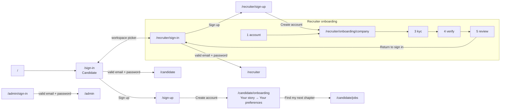
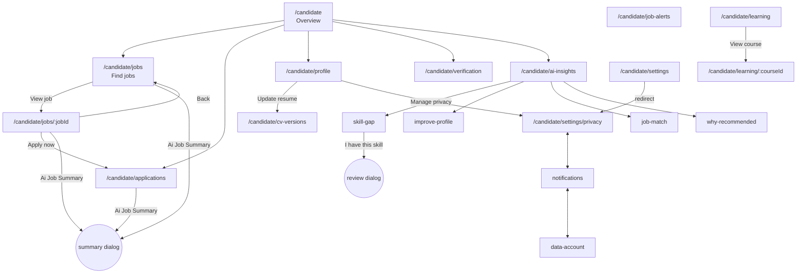
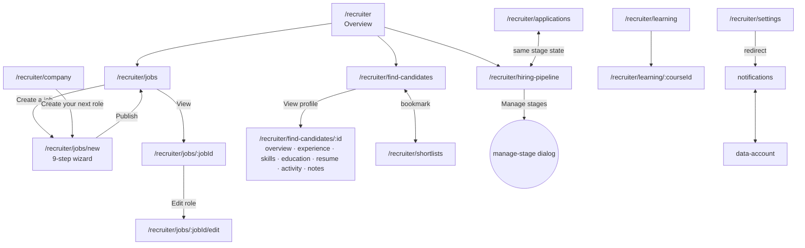
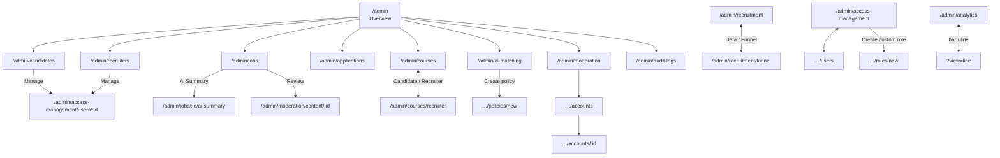

# User flow

Derived from the Figma frames (left-to-right order inside each role row, the sidebar of each workspace, and the buttons/links drawn in each frame) and from what is implemented. All flows are **demo flows over mock data**: nothing is sent to a server, and user changes persist only in the browser (`localStorage`, keys prefixed `lwm.`) — the Figma footer says "Interactive demo · Changes saved on this device".

Roles found in the file: **Candidate**, **Recruiter**, **Admin** (three role rows; three sign-in frames). The header's workspace switch moves between Candidate and Recruiter; Admin has no switch.

## 1. Entry and authentication

| Screen | Reached from | Main action → result | Validation / states | Back / cancel |
|---|---|---|---|---|
| `/sign-in`, `/recruiter/sign-in`, `/admin/sign-in` | direct URL, "Sign out" in any workspace, onboarding end | **Sign in** → loading state → that role's workspace | email required + valid format; password required; show/hide password; "demo only — nothing sent or stored" | Candidate ⇄ Recruiter radio swaps the route; "Sign up" link |
| `/sign-up` | "Sign up" on candidate sign-in | **Create account** → `/candidate/onboarding` (profile-completion, below) | required fields, email format, password rules and consent as stated in the frame | "Sign in" link |
| `/recruiter/sign-up` | "Sign up" on recruiter sign-in | **Create account** → onboarding step 2 (account fields are kept) | same | "Sign in" link |
| `/recruiter/onboarding/{account,company,kyc,verify,review}` | sign-up, or any step | **Continue** → next step; step 4 **Submit for admin review** → step 5 | per-step validation; values kept across steps (`lwm.onboarding.*`); file inputs keep only file names; passwords/OTPs never persisted; a guard redirects to the first unfinished step | **Back**; header "Sign in" exits. Step 5 "Recruiter tools locked" is disabled, exactly as drawn; "Return to sign in" |

## 2. Candidate workspace (`/candidate`)

Sidebar: Overview · Find jobs · Applications (live count badge) · Job alerts · My profile · CV & versions · Verification · AI insights · Learning; footer: Settings · Help & resources · sign out. Header: breadcrumb, ⌘/Ctrl+K quick-jump search, Candidate/Recruiter switch, language, location, notifications, profile menu.

| Screen | Main action → result | States | Notes |
|---|---|---|---|
| Overview | tabs For you / Recently added / Saved; save job; Apply now; links to every area | empty saved list; dismissible insight card | static date line is verbatim from Figma |
| Find jobs | search, location, Filters dialog, sort, **Show more jobs**, save/unsave (persisted), View job | empty results message | opens the job-summary dialog from "Ai Job Summary" |
| Job details | **Apply now** → applied state + confirmation (appears in Applications); Save for later; Back | applied / saved / not-found | breadcrumb falls back to the sidebar label "Find jobs" |
| Applications | status chips, View activity dialog, Withdraw (confirm) | empty per filter | count feeds the sidebar badge |
| Job alerts | create/edit dialog with validation, Pause/Resume, Delete (confirm) | empty list | persisted |
| My profile | Edit profile (validated modal), Ai Job Summary, Update resume, Manage privacy | | edits persisted |
| CV & versions | upload (real file input, name only), Compare (max 2), Approve / Set as live, Create assisted draft | | no download is offered; contents are not retained |
| Verification | confirm demo code, Submit for review, Mark as reviewed (labelled demo) | per-check status | |
| AI insights (5 pages) | tabs between pages; role picker (`?role=`); accept/dismiss/undo suggestions; evidence expanders; save role | review dialog with confirm checkbox | evidence over percentages; nothing is applied to a server |
| Learning / details | level filter, Buy now (confirm, no payment), mark lessons complete | purchased / not found | |
| Onboarding (2 steps) | **Step 1 "Your story":** choose/drop a resume (PDF/DOCX ≤ 10 MB; only the name is kept, nothing is uploaded), Continue or "I'll add my resume later" → step 2. **Step 2 "Your preferences":** work mode, preferred location, minimum salary (validated), **Find my next chapter** → saves to the profile (My profile and CV & versions reflect it) → `/candidate/jobs`; Back returns to step 1 | invalid file type / size, invalid location or salary | reached from candidate sign-up and the sidebar "Complete your profile" link; frames are on Figma Page 2 |
| Settings (3 tabs) | toggles, Export CSV, Delete resume, Delete my data, Reset demo (each confirmed) | | `/candidate/settings` redirects to Privacy |

## 3. Recruiter workspace (`/recruiter`)

Sidebar: Overview · Jobs · Find candidates · Shortlists · Applications · Hiring pipeline · Recruiter learning · Company.

Shared state: **shortlist** (`lwm.recruiter.shortlist`) links Find candidates, candidate profile and Shortlists; **pipeline** (`lwm.recruiter.pipeline`) links Applications, Hiring pipeline and the candidate-profile stage select; **jobs** (`lwm.recruiter.jobs`) feed Find-candidates match evidence, the Overview, and the Admin Jobs list.

| Screen | Main action → result | States / validation |
|---|---|---|
| Overview | KPI cards, funnel rows and section links open the matching page; bar/line toggle; shortlist bookmark on talent cards | |
| Jobs | status tabs, search, sort, manage menu (edit, pause/resume, publish, close with confirm, reopen) | empty + clear-filters |
| Create a job | 9-step wizard: per-step validation, skill picker, draft persisted, Save as draft / Publish | **assumption:** Figma draws step 1 only; steps 2–9 are inferred from the stepper |
| Job details | Ai Summary dialog, Edit role, Discover candidates, Review applications, Back | not-found |
| Company | edit + Save company profile; Create your next role → wizard | validation |
| Find candidates / profile | search, job select, Filters, sort, Compare, bookmark, View profile; profile tabs; Start a conversation (local preview); resume preview (no real download); notes saved | not-found |
| Shortlists | same toolbar; remove bookmark; empty state links to Find candidates | |
| Applications | search, stage filter, per-row stage select (Rejected → confirm) | empty |
| Hiring pipeline | drag or use the stage select to move cards; Manage stages (add/rename/reorder/remove, validated) | stage with candidates can't be removed |
| Learning | search, stream filter, Buy (confirm, no payment), lessons | |
| Settings / Help | toggles, export, reset; shared Help (search + FAQ accordion) | |

## 4. Admin workspace (`/admin`)

Sidebar: Overview · Candidates · Recruiters · Jobs · Applications · Recruitment · Access Management · Courses · AI & matching · Analytics · Reports · Moderation · Audit logs.

Persisted admin state: roles (`lwm.admin.roles`), per-user access (`lwm.admin.userAccess`), courses, matching policies, moderation decisions, generated report history, and an **audit log** that policy/report/moderation actions append to.

Gaps: **Admin Settings has no Figma frame** (candidate and recruiter do), so `/admin/settings` (linked from the sidebar and the profile menu) shows an explicit "not part of the supplied design" placeholder instead of an invented screen.

## 5. Cross-cutting behaviour

* **Shell:** sidebar nav with active state (prefix match, so detail pages keep their section highlighted), breadcrumb (`handle.title` per route), ⌘/Ctrl+K quick-jump, location and language preferences (profile menu and header share state, persisted), mobile drawer below 1024 px.
* **Unknown URLs:** a 404 panel inside the workspace shell (or standalone outside it).
* **Honesty rules from the design system:** AI content shows evidence, not percentages; suggestions are reviewable and dismissible; locally saved state is labelled as such; downloads/uploads that cannot exist in a demo say so instead of faking it.
